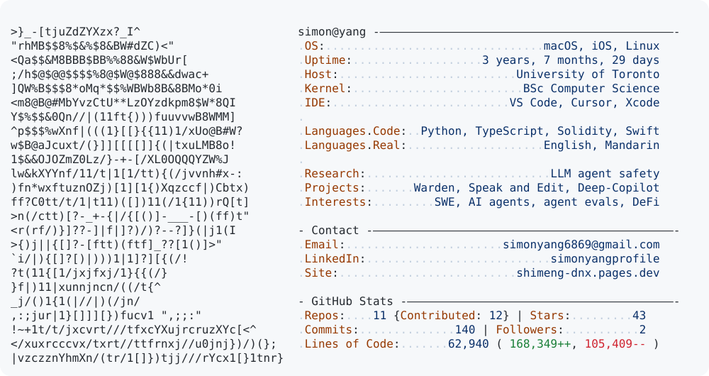

<a href="https://github.com/YSMsimon">
  <picture>
    <source media="(prefers-color-scheme: dark)" srcset="https://raw.githubusercontent.com/YSMsimon/YSMsimon/main/dark_mode.svg">
    
  </picture>
</a>

<!-- Card layout inspired by github.com/Andrew6rant/Andrew6rant (used with the author's permission). Stats refreshed daily by today.py in GitHub Actions; layout rebuilt with build_svg.py. -->
